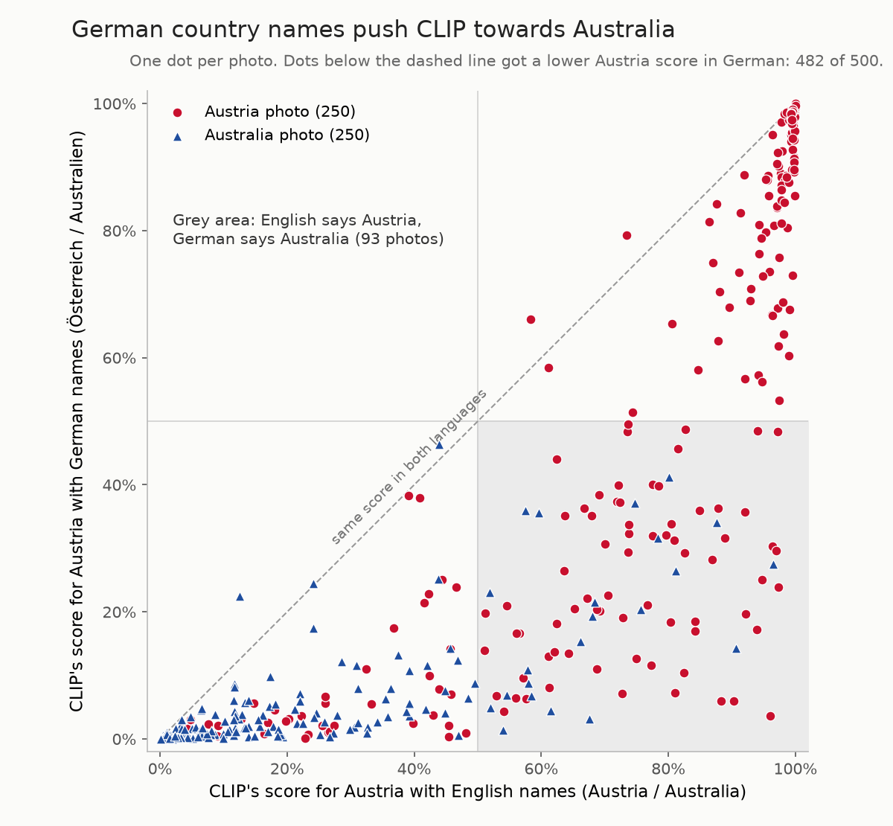
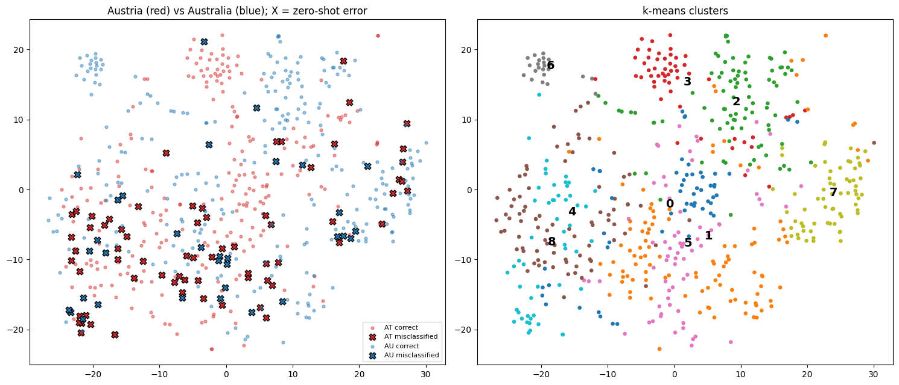
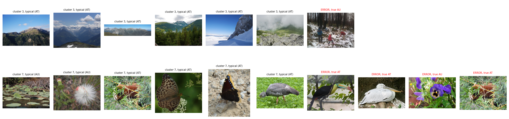
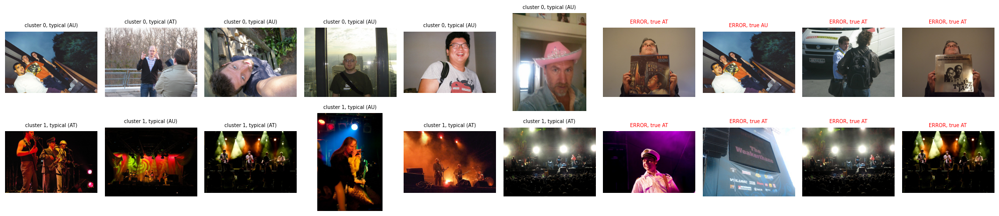

# Austria or Australia?

**Can CLIP ViT-B/32 tell two countries apart from images alone — or does it only know the postcards?**

The Visionaires · Phase I midpoint · 11 Nov 2026 · zero-shot · Country211

*Left: an Austria photo. Right: an Australia photo (both from our cached Country211 set).*

# Problem & motivation (0:00–0:35)

- Austria ↔ Australia: famously confused **by name** — but visually?
- **CLIP ViT-B/32** (OpenAI), pre-trained, used **zero-shot** — no training on our data
- **Country211**: real geotagged photos from 211 countries, incl. both of ours
- Question: does CLIP use **place evidence** — or **stereotypical scene cues**?

# Two angles on one model (0:35–0:50)

**Pair 1 · text side · AI-aided — Cristian Knebel & Alexander Strasser**

- Do the **words** in the prompt change the verdict? 3 label sets: EN / DE / mixed
- **Prediction Explorer** UI + **Language Shift** scatter

**Pair 2 · image side · no LLMs — Shamekh Al-Suwi & Eiman Mohamed**

- Does the **image content** decide — and where do errors live?
- t-SNE map, k-means clusters, density, scene probes

# Pair 1 — method (0:50–1:20)

- **500 photos** — 250 Austria + 250 Australia (Country211 train + test), cached
- 3 label sets: *EN: Austria / Australia · DE: Österreich / Australien · Mixed: Österreich / Australia*
- CLIP scores each photo under all three sets + **top-5 of all 211 countries**
- **Prediction Explorer:** photo + one bar chart per label set, ✓/✗ verdict, close-call margin, "Only mistakes"
- **Language Shift:** one dot per photo — Austria score EN (x) vs DE (y); reads the same cache

# Pair 1 — findings (1:20–2:00)

- Accuracy **86.6 %** (EN) → **76.8 %** (DE) · mixed 82.8 %
- **482 / 500** photos get a lower Austria score with German names
- **93 photos flip outright** — EN says Austria, DE says Australia (**71 are Austrian photos**)
- 139 / 500 wrong under at least one label set
- **CLIP isn't reading "Austria" — it's reading the token.**

# Pair 2 — method (2:00–2:35)

- **600 photos** (150/50/100 per country, all splits) — nothing trained, every split unseen
- 512-d embeddings; zero-shot error **17 %** with "a photo taken in …" prompts
- 5 prompt pairs to test fragility; 10-NN vote as image-side check
- 14 CLIP scene probes (explicitly unreliable); k-means k = 9 (silhouette 0.05); t-SNE map
- Sub-clustering of the worst cluster

# Pair 2 — findings (2:35–3:15)

- Clusters 0/2/3/6: **220 photos**, place-specific, error **≤ 7 %** (Vienna streets, AU coast, alpine snow, field hockey)
- Clusters 1/4/5/8: **314 photos (52 %)** hold **≈ 80 % of errors** (night skies, conferences, windows/graffiti, concerts)
- Sparser → worse: density 0.75 → 0–2 % err; 0.633/0.641 → 24–35 % err
- Stereotypes, not places: snow/buildings → Austria; wildlife/night → Australia; **20 of 27 shown errors: AT photo → "Australia"**
- Errors split **69 AT : 33 AU** — bias towards Australia
- Worst cluster splits: portraits **19 %** err vs concerts **50 %** (neighbours 27 %) → **text-side failure**

# Visual 1 — Language Shift (3:15–3:35)

- Below the diagonal = German pulled towards Australia: 482 of 500 dots
- Grey box = 93 flips: the words alone decided the country

{width=62%}

# Visual 2 — the embedding map (3:35–3:55)

- X = zero-shot error — errors pile up in the mixed centre, country islands stay clean
- 9 k-means clusters, each one kind of scene

{width=95%}

# Visual 3 — montages (3:55–4:15)

- Snow says Austria: cluster 3's only error is an Australian snowy forest
- Wildlife says Australia: cluster 7's worst errors are Austrian zoo animals (toucan, pelican)
- Cluster 8 = two problems: portraits 19 % vs concerts 50 % err — a text-side failure

{width=95%}

{width=95%}

# Two sides, one story (4:15–4:30)

- Text side: wordings move the scores — 482/500 dots shift, 93 flips
- Image side: place-specific scenes separate cleanly (≤ 7 %); otherwise stereotypes, biased to Australia
- **CLIP reads scenes, not places — and the answer is unstable under prompt changes.**

# What GenAI did — and didn't — do (optional, 4:30–4:35)

- **ChatGPT:** project idea, model + dataset, chose Language Shift & Prediction Explorer
- **Claude Code (3 agents):** 8 robustness fixes proposed for the Explorer (cache path, offline class names, Tk crash, label overlaps, stale predictions…)
- **Rejected:** uv setup ("use his setup"), dropping `.eval()`; **open:** JPEG re-encoding, train split
- From our reflection: easy results, but "it felt like a black box" — verification stayed human

# Where we stand (4:35–4:50)

- CLIP separates Austria from Australia **when the photo shows a place**; otherwise it falls back on **scene stereotypes** and flips with the prompt
- Next: train split as second dataset (≈ 300 MB), click-through scatter → explorer, requirements.txt, README IDs
- Submission — 11 Nov 2026, 23:59: public repo ✅ · AI interaction record ✅ · GenAI reflection ✅ · **video ≤ 5:00 ⬜**

<https://github.com/cristianknebel/AI-and-Visualization>
